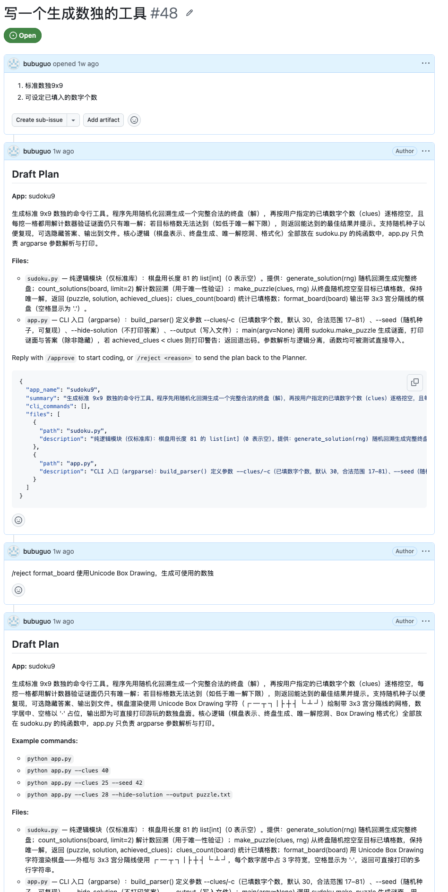
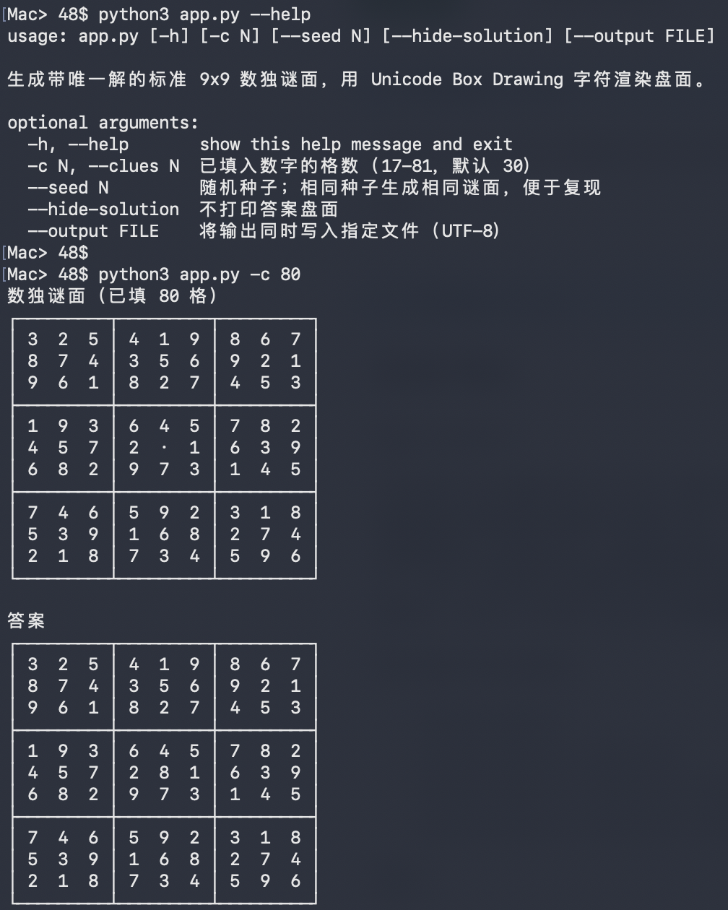

# 从 AI Coding 到 AI 开发团队：接入外部需求管理

在上一篇文章中，我们通过两个小改动让 AI 团队的鲁棒性有了很大的提升，也为后续承担更大规模的开发任务打下了基础。

不过，仔细想想，现在的 AIDevTeam 仍然存在一个比较明显的问题：

用户通过 CLI 提交 Idea，Planner 生成开发计划，人工审批之后进入编码、测试和 Review。整个过程虽然已经具备了一定的自主性和人工参与能力，但需求、计划、反馈以及执行状态，基本都围绕着内部的 LangGraph 工作流展开。

这在 Toy 阶段没有什么问题，但如果希望 AI 团队真正参与到日常软件开发中，仅仅能够独立完成编码还不够。

一个正规的开发团队，除了开发人员，还需要需求管理、任务跟踪、过程记录以及与外部人员协作的能力。

我们也应该给 AI 团队补上这些能力。

因此，这周将需求管理列为了改造重点。

经过一番考虑，GitHub 自带的 Issue 功能凭借其简单、易用以及超高的性价比（免费），自然成为了这次的选择。

不过，这次改造真正的重点并不是接入 GitHub API，而是一次架构上的调整：

**将需求管理从 AI 工作流内部迁移到外部系统。**

之前，工作流既负责执行任务，也负责维护需求上下文。现在，我们把需求交给 GitHub Issue 管理，LangGraph 则专注于工作流的执行。

这样，AI 团队就不再是一个只能通过 CLI 启动、只能在内部完成任务的封闭系统，而是开始具备与外部系统协作的能力。

这也是 AIDevTeam 从 AI Coding 工具向 AI 开发团队演进的重要一步。

## 一、代码改造

### 1. 重新定义工作流程

先回顾一下之前的工作流程。

```text
  ┌─────────┐           ┌──────┬──────┐
  ▼         │           ▼      ▼      │
Plan → Plan Approve → Code → Test → Review
                                      │
                                      ▼
                                     End
```

这是上一次改造后的流程。

用户通过 CLI 提交 Idea，Planner 根据 Idea 生成开发计划，然后通过 `interrupt()` 暂停工作流，等待人工审批。审批通过后，继续进入编码、测试和 Review 阶段。

整个过程虽然已经支持人工参与，但所有的操作基本都发生在本机，需求和开发计划也没有一个统一的外部管理入口。

这次改造后，流程变成了这样：

```text
             ┌───────────┐            ┌──────┬──────┐
             ▼           │            ▼      ▼      │
   Idea     Plan     Plan Approve → Code → Test → Review
     │       │           ▲                          │
     ▼       ▼           │                          ▼
  ┌───────────────────────────┐                    End
  │        GitHub Issue       │                          
  └───────────────────────────┘    
```

这里有几个关键变化。

首先，用户不再直接通过 CLI 提交 Idea，而是新建一个 GitHub Issue，将需求写在 Issue 中。

随后，AI Planner 根据 Issue 中的需求生成开发计划，并通过 Comment 的方式发布到对应的 Issue。

用户可以直接在 GitHub 上查看计划。如果认为计划不合理，就通过 Comment 提出修改意见；如果认为计划已经足够完善，则可以通过相应的审批操作批准当前计划。

之后，AI 团队再进入原来的 Code、Test 和 Review 流程。

最大的区别在于：**从 Idea 的提出，到开发计划的生成、修改和审批，所有重要信息都保存在我们选定的外部需求管理平台上。**

这里其实发生了一个比较重要的变化：需求不再是简单的一个命令行描述，而是具备了集成三方专业需求管理的能力。

之前，用户提交 Idea 后，Planner 将开发计划写入 State，用户的反馈也通过工作流传递。需求信息和执行状态混在了一起。

现在，我们将这两部分职责进行了拆分：

- **外部需求管理系统**：负责需求的创建、维护、计划评审、反馈以及历史记录。
- **内部 AI 工作流**：负责读取需求、制定计划、执行开发、测试和 Review。

两者通过 Issue ID 建立关联。

这样的设计有一个很重要的好处：需求不再依赖某一次工作流执行而存在。

即使 Graph 执行结束、进程重启，甚至未来我们更换底层的工作流引擎，需求及其历史记录仍然保存在 GitHub Issue 中。

反过来，如果未来我们不再使用 GitHub，而是换成 Jira 或其他需求管理系统，原则上也只需要替换外部需求管理的适配部分，而不需要重新设计整个 AI 开发流程。

当然，这次还没有专门实现一套通用适配层，但架构上已经开始朝这个方向演进。

这里需要说明的是，Plan Approve 仍然使用 LangGraph 的 `interrupt()` 机制。

因此，工作流执行到审批节点时依然会暂停。用户在 GitHub Issue 上完成 Reject 或 Approve 后，目前还需要通过 CLI 手动 Resume 对应的 Graph。

看起来这次改造反而增加了几个操作步骤。

但从实际业务角度来看，这些步骤完全可以通过 GitHub 的 Label、Webhook 等机制进一步自动化。

例如，当用户给 Issue 添加 `approved` 标签时，通过 Webhook 通知 CLI 服务，自动恢复对应的 LangGraph 工作流。

这样，整个过程就可以变成：

用户提交 Issue → AI 生成计划 → 用户审批 → AI 自动继续执行。

当然，这次先把基本流程跑通，自动化的事情就简单多了。

### 2. 定义 GitHub Issue 交互协议

确定了整体流程，接下来需要解决一个问题：AI 团队应该如何读写 GitHub Issue？

如果只是简单地把 Issue 当成一个文本存储空间，显然是不够的。

因为 GitHub Issue 的主要使用者还是人类，我们希望 Issue 中的信息能够方便人类阅读；但与此同时，AI 团队也需要能够准确地读取之前生成的开发计划和审批意见。

因此，这次需要定义一套交互协议，规范各个节点如何读取和写入 GitHub Issue。

主要包括三个方面。

**第一，将 Issue ID 作为唯一标识。**

之前我们使用 `run_id` 标识一次工作流执行。

现在既然一个需求对应一个 GitHub Issue，那么就没有必要再额外维护一套标识了。

直接使用 GitHub Issue ID 作为任务的标识，并且让 LangGraph 中的 `thread_id` 与 Issue ID 保持一致。

这样，外部需求和内部工作流就建立了直接关联。

后续无论是读取 Issue、更新 Comment，还是恢复之前暂停的工作流，都可以通过同一个 Issue ID 找到对应的任务。

**第二，修改工作流启动入口。**

之前 CLI 的启动方式是直接传入 Idea 的文本描述。

现在则改为传入 GitHub Issue ID。

也就是说，CLI 不再负责接收和管理需求内容，而是根据 Issue ID 从 GitHub 获取对应的需求信息，再启动工作流。

这样做的一个好处是，CLI 不需要关心需求内容本身，只需要知道当前要处理哪个 Issue。

**第三，统一 Plan 的发布格式。**

Planner 生成开发计划后，需要将计划发布到 GitHub Issue 的 Comment 中。

这里采用了一个比较简单的设计：将 Comment 分成两个部分。

第一部分是自然语言描述，主要面向人类。

例如：

- 本次开发的目标。
- 计划实现的功能。
- 具体的开发步骤。
- 需要注意的问题。

第二部分是 JSON 格式的结构化数据，主要面向 AI 团队后续的节点。

例如：

```json
{
  "app_name": "sudoku9",
  "summary": "生成标准 9x9 数独的命令行工具。程序先用随机化回溯生成一个完整合法的终盘（解），再按用户指定的已填数字个数（clues）逐格挖空，且每挖一格都用解计数器验证谜面仍只有唯一解；若目标格数无法达到（如低于唯一解下限），则返回能达到的最佳结果并提示。支持随机种子以便复现，可选隐藏答案、输出到文件。核心逻辑（棋盘表示、终盘生成、唯一解挖洞、格式化）全部放在 sudoku.py 的纯函数中，app.py 只负责 argparse 参数解析与打印。",
  "cli_commands": [],
  "files": [
    {
      "path": "sudoku.py",
      "description": "纯逻辑模块（仅标准库）：棋盘用长度 81 的 list[int]（0 表示空）。提供：generate_solution(rng) 随机回溯生成完整终盘；count_solutions(board, limit=2) 解计数回溯（用于唯一性验证）；make_puzzle(clues, rng) 从终盘随机挖空至目标已填格数，保持唯一解，返回 (puzzle, solution, achieved_clues)；clues_count(board) 统计已填格数；format_board(board) 输出带 3x3 宫分隔线的棋盘（空格显示为 '.'）。"
    },
    {
      "path": "app.py",
      "description": "CLI 入口（argparse）：build_parser() 定义参数 --clues/-c（已填数字个数，默认 30，合法范围 17–81）、--seed（随机种子，可复现）、--hide-solution（不打印答案）、--output（写入文件）；main(argv=None) 调用 sudoku.make_puzzle 生成谜面，打印谜面与答案（除非隐藏），若 achieved_clues < clues 则打印警告；返回退出码。参数解析与逻辑分离，函数均可被测试直接导入。"
    }
  ]
}
```

这样，Planner、Coder 和 Tester 就可以按照统一的格式读取开发计划，而不需要每次都从自然语言描述中重新理解任务。

人类可以直接阅读 Comment，AI 则可以读取其中的 JSON 数据。

两者使用同一份信息，避免了需求描述和机器实际执行内容之间出现偏差。

当然，这只是当前版本的协议。后续随着功能进行演化增加，所以我们以注释的方式在 Comment 最后增加了当前协议的版本号，既不影响人类对Comment的阅读，又让机器方便的识别。

```
<!-- aidevteam: v1:plan -->
```

### 3. State 轻量化：将需求上下文从工作流中剥离

前面解决了 GitHub Issue 的读写问题，接下来还有一个值得关注的地方：LangGraph 的 State。

还记得之前的设计吗？

我们将开发计划、用户反馈以及审批记录等信息都保存在 State 中。

这种设计在最初没有什么问题，但随着需求管理功能的加入，State 中保存的信息越来越多。

实际上，这些信息并不都属于工作流执行状态。

例如，开发计划和用户的审批意见，本质上是需求管理信息。它们需要长期保存、随时查询，而且可能在多次工作流执行之间持续存在。

如果继续把这些内容全部放在 LangGraph State 中，就会产生两个问题：

1. State 越来越臃肿，增加了状态持久化和恢复的负担。
2. 需求信息与工作流执行状态耦合在一起，不方便独立管理和复用。

因此，这次对 State 做了一次轻量化改造。

我们将需求相关的信息统一定义为 `IssueContext`，需要使用时直接从 GitHub Issue 中读取，而不是一直保存在 State 中。

State 则只保留当前工作流真正需要的执行信息。

新的 `TeamState` 定义如下：

```python
class TeamState(TypedDict, total=False):
    issue_id: int
    code: CodeResult
    test_report: TestReport
    review: Review
    approved: bool
    plan_approved: bool
    iteration: int
```

可以看到，相比之前的版本，移除了 Plan 和 Feedback 等相关字段，只保留了 `issue_id` 作为外部需求的引用。

这样一来，State 就清爽多了。

这里实际上完成了一次职责划分：

- GitHub Issue：负责保存需求、开发计划、用户反馈和审批记录。
- LangGraph State：负责保存工作流当前执行所需的状态。
- `thread_id`：负责将外部 Issue 与内部工作流关联起来。

这样，我们不再需要依赖 LangGraph State 来保存所有的历史信息。

需要某个历史计划时，从 Issue 中读取；需要恢复工作流时，通过 `thread_id` 找到对应的 Checkpoint。

**把长期需求上下文交给外部系统管理，把执行状态留给工作流自己管理。**

这应该是本次改造最重要的变化。

## 二、执行效果

这次我选择了一个比较直观的需求：生成一个 Web 版数独游戏。

首先，在 GitHub 上创建一个 Issue，描述希望实现的功能。



随后，通过 CLI 将 Issue ID 传给 AI 团队。

Planner 读取 Issue 中的需求，生成开发计划，并将计划发布到对应的 Comment 中。

我可以直接在 GitHub 上查看计划，并通过 Comment 与 Planner 进行交互，提出修改意见。

经过几轮调整，最终确认开发计划，审批通过后，工作流继续执行。

之后就是熟悉的环节了。

Coder、Tester 和 Reviewer 各司其职，完成代码实现、测试和 Review。

最终，一个可以运行的 Web 版数独游戏就完成了。



可以看到，这次我们并没有改变原有的核心开发流程，而是通过 GitHub Issue 为它增加了一个外部需求管理入口。

从需求提出、计划生成，到人工审批和后续执行，都可以在 GitHub 上找到对应的记录。

## 三、后记：从内部工作流走向外部协作

回顾这次改造，表面上看，我们只是给 AIDevTeam 接入了 GitHub Issue，让用户可以通过 Issue 提交需求、查看开发计划和提出修改意见。

但实际上，这次改造完成了一次比较重要的架构转变：

**将需求管理从 AI 工作流内部迁移到了外部系统。**

之前，AIDevTeam 更像是一个封闭的自动化程序。用户通过 CLI 提交任务，LangGraph 负责维护任务上下文和执行状态，所有的事情都围绕着内部工作流展开。

现在，我们开始将不同职责交给更合适的系统：

- **GitHub Issue**：负责需求管理，保存需求、计划、反馈和审批记录。
- **LangGraph**：负责工作流编排，管理任务执行过程和节点状态。
- **CLI**：负责连接外部需求管理系统与内部工作流，承担任务启动和恢复的职责。

这几个部分通过 Issue ID 关联起来，形成了一个相对清晰的架构。

这次改造带来的好处也不仅仅是方便管理需求：

1. **回溯与审计**：需求、开发计划和审批意见都有独立的存储位置，可以随时查看之前的决策过程。
2. **按需读取**：Agent 不再需要一直携带所有历史需求信息，需要时从 Issue 中读取即可。
3. **职责解耦**：需求管理与工作流执行相互独立，未来可以更换外部需求管理平台，而不必大幅修改内部 Graph。
4. **Context 管理**：将长期需求信息从 State 中剥离，减少工作流中不必要的数据，为后续 Context 优化提供基础。

更重要的是，**AI 团队终于开始具备与外部世界协作的能力。**

我们可以通过 GitHub Issue 提交需求，通过 Comment 参与计划评审，未来还可以通过 Webhook、Label 等机制触发工作流，实现更加自动化的协作。

这意味着 AIDevTeam 不再只是一个能够自动写代码的工具，而是开始拥有一个开发团队应该具备的外围协作体系。

下一次，我们可以搞点大的了。

另外也可以思考为什么当前不适合将bug管理和代码管理也放入Github。这个计划在稍后的文章中予以解答