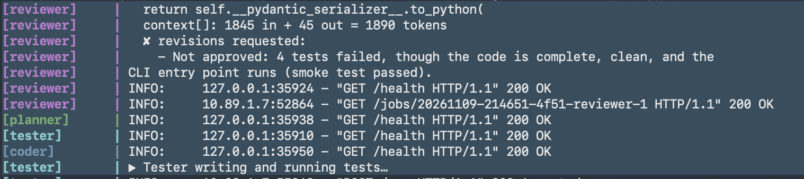

# 从 AI Coding 到 AI 开发团队：两个小改动让团队更健壮 

在上一篇文章中，我们通过使用数据库代替 `MemorySaver`，让 AI 团队具备了状态持久化能力。即使遇到进程宕机、服务重启等异常情况，也可以从之前保存的工作流状态继续执行。

不过，随着 AI 团队开始承担更多实际开发任务，我发现又出现了一些新的问题。

最近使用 AI 团队时，好像模型服务最近不是很稳定。我在不同的 Module 之间切换，发现了两个比较明显的问题：

1. LLM 返回错误，导致工作流执行失败。
2. Tester 生成的测试代码存在问题，导致测试无法正常执行。

对于第一个问题，目前的代码对 LLM 的执行过程完全没有监控。一次调用失败，我们很难判断究竟是模型服务本身出现了问题，还是 Context Window 被塞满了。

对于第二个问题，之前的 Graph 设计也存在一些不够合理的地方。即使 Reviewer 已经发现问题出在测试代码上，工作流仍然会返回 Coder 节点，要求重新实现代码，然后再让 Tester 重新生成测试代码。

这显然会产生很多不必要的 LLM 调用。

因此，这次准备对 AIDevTeam 做两方面的改造：

- 增加 LLM 调用监控，统计每次调用的输入和输出 Token，帮助我们定位模型调用问题。
- 优化 Graph 的执行路径，让 Reviewer 能够根据问题类型，将任务准确地返回给 Coder 或 Tester。

## 一、代码改造

### 1. 增加 LLM 监控

首先解决 LLM 调用不可观测的问题。

之前在 `llm.py` 中，我们直接使用 `ChatOpenAI` 创建模型实例，然后将其交给各个 Agent 使用。

这种方式虽然简单，但有一个问题：LLM 的调用分散在不同的 Agent 中，我们很难统一观察每次调用的情况。

因此，这次增加一个包装类 `MonitoredLLM`，将原始 LLM 包装起来。

它主要负责两件事情：

1. 包装原始 LLM 的调用方法。
2. 在调用完成后统计输入和输出 Token 数量。

Token 统计这里使用了 `tiktoken` 提供的 `count_tokens` 方法。

需要特别说明的是，`tiktoken` 是 OpenAI 提供的 Tokenizer 工具，不同模型使用的 Tokenizer 可能并不相同。因此，对于 OpenAI 模型之外的其他模型，统计结果只能作为参考，不能认为它就是模型服务端实际计算的 Token 数量。

这次主要对 `invoke` 和 `ainvoke` 两个方法进行包装，分别对应同步和异步调用。

整体思路如下：

```python
class MonitoredLLM:

    def __init__(self, llm):
        self.llm = llm

    def invoke(self, messages, config=None, **kwargs):
        response = self.llm.invoke(
            messages, config=config, **kwargs
        )

        # 统计输入和输出 Token
        input_tokens = count_tokens(messages)
        output_tokens = count_tokens(response.content)

        print(
            f"LLM Tokens: "
            f"input={input_tokens}, "
            f"output={output_tokens}"
        )

        return response

    async def ainvoke(self, messages, config=None, **kwargs):
        response = await self.llm.ainvoke(
            messages, config=config, **kwargs
        )

        # 统计输入和输出 Token
        input_tokens = count_tokens(messages)
        output_tokens = count_tokens(response.content)

        print(
            f"LLM Tokens: "
            f"input={input_tokens}, "
            f"output={output_tokens}"
        )

        return response
```

这里展示的是核心逻辑，实际实现中还需要根据项目使用的消息类型处理输入内容，并考虑异常处理以及其他 Runnable 接口的兼容性。

另外，为什么选择在原始方法执行完成后统计？

因为这样不需要修改原有 Agent 的调用方式。对于上层代码来说，它仍然是在调用一个 LLM，只不过现在每次调用都会额外输出 Token 统计信息。

这样一来，当某个 Module 执行失败时，我们就可以观察它之前的 LLM 调用情况。

如果输入 Token 持续增长，就需要重点关注 Context Window 是否接近上限；如果 Token 数量并不异常，却频繁出现调用失败，则可以进一步检查模型服务、网络连接以及 API 返回错误。

当然，Token 数量只能帮助我们缩小排查范围，并不能直接判断错误原因。后续还需要进一步记录模型名称、调用耗时、异常信息等数据。

至少现在，我们不再是完全摸黑排查了。

### 2. function_calling vs. json_schema

除了监控问题，这次还顺手解决了一个之前一直比较困扰我的问题。

在不同模型之间切换时，我发现 Structured Output 偶尔会出现一些奇怪的解析错误。

例如：

```text
Value error, files must be a list or a JSON-encoded list string:
Expecting value: line 1 column 38 (char 37)

[type=value_error,
 input_value='[{"path": "wordcount.py"...ys.exit(main())\\n\\"}]',
 input_type=str]
```

从错误信息来看，原本应该返回一个 List 的字段，却被模型返回成了无法正常解析的字符串。

这让我开始怀疑，不同模型在处理 Structured Output 时，对底层编码方式的支持可能存在差异。

之前使用的是默认的 Structured Output 实现，而 LangChain 的 `with_structured_output()` 支持指定不同的实现方式。

这次改为显式使用 `json_schema`：

```python
llm.with_structured_output(
    schema,
    method="json_schema"
)
```

与 `function_calling` 不同，`json_schema` 使用 JSON Schema 约束模型的输出结构，而不是通过工具调用的形式获取结构化结果。

两种方式都有各自的适用场景，具体表现也会受到模型和服务提供商实现的影响。

目前在我的实际使用中，切换到 `json_schema` 后，观察到的结果比之前稳定。

这次测试了 4、5 种不同的模型，没有再出现之前类似的 List 解包错误。

当然，这并不意味着 `json_schema` 一定比 `function_calling` 更好。不同模型对结构化输出的支持程度不同，实际项目中还是需要根据模型能力进行测试。

不过，至少对于当前的 AIDevTeam 来说，这个调整解决了一个比较明显的兼容性问题。

### 3. 优化 Graph 的执行路径

前面解决了 LLM 调用的可观测性，接下来处理第二个问题：测试代码本身存在错误。

还记得之前 AIDevTeam 的开发流程吗？

Coder 负责实现代码，Tester 根据实现生成测试用例，最后 Reviewer 对整个结果进行检查。

之前的 Graph 大致是这样的：

```text
       ┌─────────┐
       ▼         │
Plan → Coder → Tester → Reviewer
         ▲                 │
         └─────────────────┘
                           │
                           ▼
                          End
```

当 Reviewer 发现问题时，工作流会重新返回 Coder。

这种设计在大多数情况下没有问题。毕竟，如果是实现代码存在 Bug，确实应该让 Coder 重新修改。

但是，最近发现有时问题并不在 Coder，而是 Tester 生成的测试代码本身存在错误。

例如：

- 测试断言与实际需求不一致。
- 测试用例没有覆盖必要的场景。
- 测试代码本身无法正常运行。

这些问题实际上应该由 Tester 负责修复。

但按照之前的执行路径，即使 Reviewer 已经发现是测试代码的问题，工作流仍然会返回 Coder。

于是就产生了一个比较尴尬的过程：

```text
Reviewer 发现测试代码有问题
              │
              ▼
         返回 Coder
              │
              ▼
         重新实现代码
              │
              ▼
         Tester 重新生成测试
              │
              ▼
          Reviewer
```

Coder 可能只是重新生成了一遍原本就正确的代码，Tester 又重新生成了一遍测试用例。

这不仅浪费 Token，也增加了整个工作流的执行时间。

因此，这次准备让 Reviewer 根据问题类型决定下一步应该交给谁处理。

首先，在 Reviewer 的 Prompt 中增加一个字段 `revision_target`：

```text
Also set `revision_target`:
- "code" if the implementation needs fixing
  (bugs, missing features, plan mismatches).
- "tests" if the code looks correct but the test cases are bad
  (wrong assertions, missing coverage, tests that crash).
```

这个字段用于告诉 Graph 当前需要修改的对象：

- `code`：实现代码存在问题，需要返回 Coder。
- `tests`：实现代码没有问题，但测试用例存在问题，需要返回 Tester。

有了这个字段，就可以修改 Reviewer 后面的条件边。

之前 Reviewer 只有一个返回 Coder 的分支，现在增加 Tester 分支：

```python
graph.add_conditional_edges(
    "reviewer",
    _route_after_review,
    {
        "coder": "coder",
        "tester": "tester",
        END: END
    }
)
```

这样，Reviewer 就可以根据审核结果直接选择下一步执行节点。

新的执行路径如下：

```text
  ┌─────────┐           ┌──────┬──────┐
  ▼         │           ▼      ▼      │
Plan → Plan Approve → Code → Test → Review
                                      │
                                      ▼
                                     End
```

其中 Reviewer 可以根据 `revision_target`：

- 返回 `coder`，重新实现代码。
- 返回 `tester`，重新生成测试用例。
- 返回 `END`，结束当前工作流。

这样就避免了测试代码有问题时，还需要让 Coder 重新执行一遍。

当然，这里有一个前提：Reviewer 必须能够正确区分代码问题和测试问题。如果判断错误，工作流仍然可能走向不合适的节点。

不过，将问题分类和执行路径分离，本身就是一次有价值的改进。后续即使需要增加更多的处理节点，也可以沿用类似的设计。

## 二、执行效果

经过这次改造，AIDevTeam 的执行过程有了两个比较明显的变化。

### 1. LLM 调用情况更加直观

```
context[]: 959 in + 1197 out = 2156 tokens
```

现在每次调用 LLM 后，都会输出对应的输入和输出 Token 数量。

这样在不同 Module 之间切换时，可以比较直观地看到各个 Agent 的 Context 使用情况。

尤其是当某个任务执行时间比较长时，可以观察输入 Token 是否随着迭代不断增长。

这也为后续优化 Context 提供了一个比较明确的方向。

### 2. function_calling vs. json_schema

除了监控问题，这次还顺手解决了一个之前一直比较困扰我的问题。

在不同模型之间切换时，我发现 Structured Output 偶尔会出现一些奇怪的解析错误。

例如：

```
Value error, files must be a list or a JSON-encoded list string:
Expecting value: line 1 column 38 (char 37)

[type=value_error, input_value='[{"path": "wordcount.py"...ys.exit(main())\\n\\"}]', input_type=str]
```

从错误信息来看，原本应该返回一个 List 的字段，却被模型返回成了无法正常解析的字符串。

看起来不同模型对 function_calling 的返回格式处理存在一定差异，而 LangChain 在解析这些结果时，也可能受到模型具体实现的影响。

因此，这次尝试换一种方式，显式指定使用 json_schema：

llm.with_structured_output(
    schema,
    method="json_schema"
)

与 function_calling 不同，json_schema 通过 JSON Schema 约束模型的输出结构，而不是通过工具调用的形式获取结构化结果。

目前在我的实际使用中，切换到 json_schema 后，观察到的结果比之前稳定。

测试了 4、5 种不同的模型，没有再出现之前类似的 List 解析错误。

当然，这并不意味着 json_schema 一定比 function_calling 更好。不同模型对结构化输出的支持程度不同，实际项目中还是需要根据模型能力进行测试。

不过，至少对于当前的 AIDevTeam 来说，这个调整解决了一个比较明显的兼容性问题。

### 3. Reviewer 可以直接返回 Tester



从执行结果可以看到，当 Reviewer 判断问题出在测试代码时，不再要求 Coder 重新实现，而是直接跳转到 Tester 节点重新生成测试用例。

这样就形成了更加合理的执行路径。

相比之前不区分问题类型、一律返回 Coder 的方式，现在可以减少一些没有必要的 LLM 调用。

## 三、下一步

通过这次改造，AIDevTeam 又向前迈进了一小步。

这次主要解决了两个问题：

- `MonitoredLLM`：增加 LLM 调用监控，通过输入和输出 Token 统计，让 Context 使用情况更加直观。
- `json_schema`：调整 Structured Output 的实现方式，改善不同模型之间的兼容性。
- Graph 条件边：根据 Reviewer 的判断结果，将任务分别返回 Coder 或 Tester，减少不必要的重复执行。

不过，这次改造也让我发现了一个新的问题。

目前我们虽然能够看到每次 LLM 调用的 Token 数量，但还没有真正建立 Context 管理机制。

当任务越来越复杂，Agent 需要反复读取文件、执行测试、接收 Review 意见时，Context 很可能会不断增长。

如果只是监控，而不主动控制，最终还是可能遇到 Context Window 超限的问题。

因此，下一步准备重点研究 Context 管理，包括如何控制上下文长度、如何保留重要信息，以及如何在必要时对历史信息进行压缩。

毕竟，让 AI 自己开发只是第一步。要让 AI 团队长期稳定地工作，除了给它们安排好任务，还得关注它们是不是已经把脑子塞满了。

至少现在，我终于可以知道它们的脑子到底塞了多少东西了。

