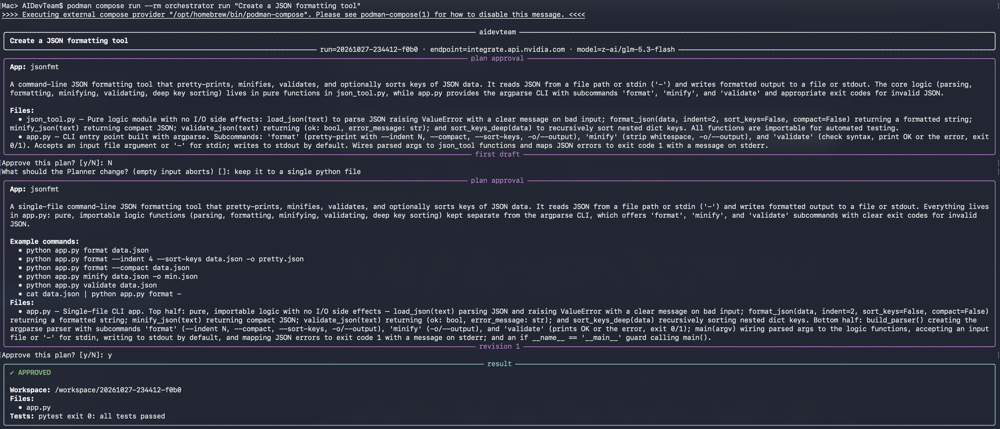

# 从 AI Coding 到 AI 开发团队：我要参与

在上一篇文章中，我们对 AIDevTeam 进行了容器化改造，为 AI 建立了基础的安全围栏。

然而，最近打水的频率显著增加，肾结石都变小了。

但作为一个超级资深程序员，长期坐在旁边看 AI 自己干活，实在缺乏参与感。

我决定重新体现一下自己的重要性：在 AI 输出开发计划之后，我要提出修改意见，让 AI 在我的指导下把工作做得更加完美。

当然，这不只是为了满足我的参与感。

在实际业务中，让人参与 AI 的执行过程是一个很常见的需求。例如，等待用户补充信息、等待外部任务完成、等待资源就绪，或者在执行高风险操作之前要求人工授权。

这些场景有一个共同点：**工作流需要在某个节点暂停，等待外部条件满足后，再从原来的位置继续执行。**

## 一、让工作流暂停

在 AIDevTeam 中，Planner 负责生成开发计划。在之前的版本中， AI 直接按照计划进入编码阶段。

这个版本中，如果计划合理，就继续执行；如果需要调整，就把修改意见交给 AI，让 AI 根据意见重新完善计划。

这样，工作流就变成了：

```text
  ┌─────────┐           ┌─────────────┐
  │         │           │             │
  ▼         │           ▼             │
Plan → Plan Approve → Code → Test → Review
                                      │
                                      ▼
                                     End
```

当然，并不意味着只能增加一个人工审批节点，我们可以根据任务风险，在合适的位置增加人工节点，永续人工的介入。

说到这里，就需要用到 LangGraph 提供的 `interrupt()` 机制。

它不仅可以暂停工作流，还能配合状态持久化机制，让工作流在外部输入到达后恢复执行。整个过程可以拆成四件事：

1. 暂停工作流，并向调用方提供需要审核的信息。
2. 保存工作流状态，以便后续恢复。
3. 接收人工审批结果，并关联到原来的执行任务。
4. 恢复工作流，根据审批结果继续执行。

下面看看具体怎么实现。

## 二、具体实现

### 1. 增加 `approve_plan` 节点

首先，需要在 Planner 之后增加一个 `approve_plan` 节点，用于人工审批。

在这个节点中调用 `interrupt()`，将需要审核的信息交给调用方。

例如：

```python
def approve_plan(state: TeamState) -> dict:
    plan = state.get("plan")
    interrupt(
        {
            "plan": plan.model_dump() if isinstance(plan, BaseModel) else plan,
            "revision": state.get("iteration", 0),
        }
    )
    ...
```

这里传给 `interrupt()` 的对象，就是人工审核所需要的内容。

这里额外带上了 `revision`，用于标识当前计划对应的迭代版本。这样在后续反复修改计划时，也更容易区分。

当工作流执行到 `interrupt()` 时，LangGraph 会暂停当前执行，并将中断信息返回给调用方。调用方可以展示当前计划、等待用户确认，再将审批结果传回来。

需要注意的是，`interrupt()` 并不是普通的函数返回。恢复工作流时，LangGraph 会重新执行包含 `interrupt()` 的节点，并将恢复时传入的值作为这次 `interrupt()` 调用的返回值。因此，在它之前尽量不要执行不可重复的操作。

### 2. 使用 thread_id 关联工作流

还记得第一版中，我们是通过 `graph.invoke()` 启动工作流的吗？

这次需要额外提供一个 `thread_id`，用来标识需要持久化和恢复的工作流。

有了这个标识，LangGraph 就可以将当前执行与对应的状态记录关联起来。后续恢复时，只要继续使用相同的 `thread_id` 和对应的 Checkpointer，就能找到之前暂停的工作流。

```python
    config = {"configurable": {"thread_id": run_id}, "recursion_limit": 60}
    state: dict = graph.invoke(
        {"task": task, "run_id": run_id, "iteration": 0}, config
    )
```

我们定义的 `run_id` 本来就是全局唯一的，这里直接将 `run_id` 作为 `thread_id` 使用。

### 2. 读取暂停内容

在暂停后，可以通过返回状态中的 `__interrupt__` 读取相应的暂停内容

```python
    while state.get("__interrupt__"):
        payload = state["__interrupt__"][0].value or {}
        
        # retrieve interrupt payload
        # payload.get("plan")
```

可以看到state["__interrupt__"]其实是个List对象，这里留个尾巴，以后用到再说

这里的 `__interrupt__` 是一个中断信息集合，即使当前只有一个中断，也需要通过索引获取对应的中断对象，再从它的 `value` 中读取传出的数据。

为什么它是一个集合，而不是直接返回一个对象？

这里留个尾巴，以后用到再说。

### 3. 恢复工作流

拿到计划后，调用方就可以进行人工审批了。

例如，如果用户认为计划还需要修改，可以提交：

```python
resume = {
    "approved": False,
    "feedback": "补充异常输入处理"
}
```

如果用户认为计划可以编码了，可以提交：

```python
resume = {"approved": True, "feedback": ""}
```

然后通过Command(resume=...)，恢复工作流

```python
graph.invoke(Command(resume=resume), config)
```

这里的 `Command(resume=...)` 用于向之前的 `interrupt()` 传回恢复值。恢复时使用的 `config` 中的 `thread_id` 需要与启动时相同， LangGraph 据此定位之前的工作流，而不是重新创建一条执行流程。

之后的 `approve_plan` 节点中，`interrupt()` 就会返回这个 `resume` 对象。节点再继续把审批结果返回给写入状态，后续条件边便可以根据 `approved` 和 `feedback` 决定下一步。

### 4. 重要的一环：状态到底存在哪里？

前面的流程已经讲完了，但还有一个关键问题没有回答：

**工作流中断之后，状态究竟存在哪里？恢复时又从哪里读取？**

前面使用 `thread_id`，只是告诉 LangGraph 应该关联哪条工作流线程。它本身并不负责保存状态。

真正承担这个职责的是 Checkpointer。

在当前版本中，我使用了 `MemorySaver`：

```python
return graph.compile(
    checkpointer=MemorySaver(
        serde=JsonPlusSerializer(
            allowed_msgpack_modules=_msgpack_allowlist()
        )
    )
)
```

编译 Graph 时配置 Checkpointer，LangGraph 就可以在工作流执行过程中保存状态，并在后续调用时根据 `thread_id` 恢复相应的执行现场。

这里的 `JsonPlusSerializer` 用于处理状态的序列化和反序列化，`allowed_msgpack_modules` 则用于配置允许反序列化的模块类型。

不过，`MemorySaver` 的状态保存在当前进程的内存中。这意味着，只要进程退出或重启，之前保存的状态就可能丢失。

后面我们会解决这个问题。

### 5. 跑一遍


我们看到，在我发表意见后 Planer 在此意见上重新制定了开发计划。实际上我们还可以进行多轮的审批，这里为了展示方便之进行了一次。


## 三、下一步

通过这次改造，AIDevTeam 具备了人工参与工作流的基本能力。

Planner 不再生成计划后就直接进入编码阶段，而是可以先停下来等待我的意见。批准之后继续执行，需要修改时则将反馈交给 AI 重新完善计划。

这次实现的核心其实并不复杂：

- `interrupt()` 负责暂停并传递待处理的信息。
- `thread_id` 用于关联同一条工作流线程。
- Checkpointer 负责保存和恢复工作流状态。
- `Command(resume=...)` 负责传回外部输入，让工作流继续执行。

把这些机制组合起来，就可以实现一个能够暂停、等待、恢复的工作流。

当然，目前我们只是在 Planner 和 Coder 之间增加了人工审批。后续还可以在高风险操作、外部资源变更等环节加入更有针对性的审批机制。

毕竟，让 AI 至于一定的监督下，才能放心让 AI 承担更多工作。

至少现在，我终于有机会在 AI 开始写代码之前，认真地发表一下意见了。