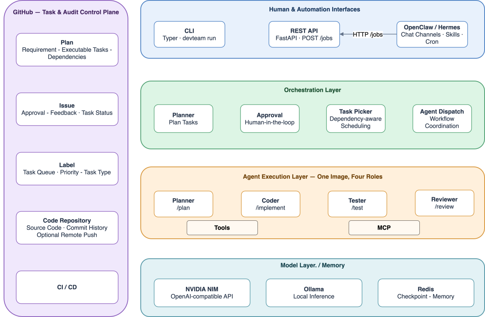

# 从 AI Coding 到 AI 开发团队：一个实验的开始

最近，我决定开始做一个**AIDevTeam**新项目。

在这里想记录下自己开发 AI Agent 的过程与体会，也希望通过持续迭代和演化，最终将这个项目打造成一个真正可用的 **AI 开发团队**, 不是简单地让 AI 帮我写代码，而是尝试让 AI 具备一套相对完整的软件开发能力：从理解需求、制定方案，到编写代码、验证结果，再到发现问题并持续改进。

这个想法并不是突然冒出来的，而是源于最近的几段经历。

## 一、为什么想做这件事？

### 1. AI 写的代码，最后还是要有人维护

最近，我想给一个内部流水线的模块增加个功能。

原本以为只是一次普通的功能迭代，但真正开始接触代码后，才发现事情并没有那么简单。

项目中的代码由不同的人借助不同的 AI 工具生成，代码风格各异，dead code 随处可见，一些过度设计也混杂其中。更麻烦的是，项目缺乏完整的测试流程，很多改动都很难得到充分验证。

结果就是，每次修改都得格外小心。

一个看似简单的优化，可能影响整个流水线的运行。由于缺乏足够的测试保障，我们很难确定改动的影响范围，只能尽可能谨慎地修改。

这让我意识到一个问题：

**AI 能够快速生成代码，并不意味着这些代码就容易维护。**

当 AI Coding 越来越普及，代码的生成成本不断降低，但如果缺少统一的规范、验证机制和质量保障，后续的维护成本反而可能越来越高。

我们需要的不只是一个会写代码的 AI，还需要一套能够约束和管理代码生产过程的机制。

### 2. AI Coding 的效率，确实超出了我的预期

与此同时，课余时间，我还借助 AI Coding 工具独立完成了一个小应用：https://bubuguo.github.io/EnglishPod/

它支持 Web 浏览器访问、PWA 安装，以及 Android APK 发布。

整个开发过程中，几乎所有代码都由 AI 完成。我主要负责提出需求、明确功能方向，以及在必要时给出修改意见。

如果要形容我的角色，与其说是在编写代码，不如说是在描述目标、做出决策，并引导 AI 不断调整实现。

这个过程让我真切地感受到：对于规模合适的应用，AI 已经能够承担相当大一部分实际开发工作。

过去，一个人想要独立完成从功能实现到多端发布的整个过程，往往需要投入大量时间。

现在，借助 AI Coding 工具，这件事变得容易了很多。

当然，这并不意味着 AI 可以完全脱离人的监督。需求是否合理、实现是否正确、发布是否可靠，依然需要有人负责。

但至少有一点已经越来越明确：

**软件开发的瓶颈，正在从「如何写出代码」，逐渐转向「如何组织、验证和持续改进代码的生产过程」。**

这也让我开始思考：既然 AI 已经能够完成这么多开发工作，我们能不能进一步把它组织起来，让它像一个团队一样协作？

### 3. AI Agent 框架已经具备了进一步探索的基础

最近，我也花了一些时间学习当前的 AI Agent 框架。

随着相关技术的发展，我们已经可以借助工作流编排、工具调用、状态管理等机制，把原本依赖单轮对话完成的任务，组织成一个包含多个步骤、能够持续执行的流程。

这让我觉得，构建一个 AI 开发团队，不再只是一个停留在概念层面的想法。

虽然距离真正可靠地开发和维护中型应用，还有不少问题需要解决，但至少已经有了值得尝试的技术基础。

于是，我决定动手做一个实验。

## 二、我想解决的究竟是什么问题？

在我看来，当前常见的 AI Coding 使用方式，大致可以抽象成这样一个循环：

```text
提出需求 → AI编写代码 → 发现新需求或Bug → 继续让 AI 修改代码 → 结束
                       ↑                  |
                       └──────────────────┘
```

这种方式简单直接，在开发小应用时尤其高效。

但随着项目规模不断扩大，问题也会逐渐显现。

首先，开发过程缺乏统一的组织方式。

AI 可以根据当前的指令完成任务，但整个开发过程中的需求分析、方案设计、代码实现、测试验证和结果检查，未必形成了一个完整、稳定的闭环。

其次，缺少明确的执行边界和退出机制。

一个任务什么时候算完成？修改之后需要执行哪些测试？测试失败后应该继续尝试，还是回退方案？如果 AI 一直无法解决问题，什么时候应该停止并交由人处理？

如果这些问题没有明确的规则，开发过程就很容易陷入反复修改的循环。

最后，代码质量很难随着开发过程持续得到保障。

如果每次修改都只是针对眼前的问题，那么随着功能不断增加，代码可能逐渐积累重复逻辑、过度设计、缺乏测试等问题。短期内开发速度很快，长期来看却可能越来越难以维护。

因此，我想尝试解决的，并不是如何让 AI 写出更多代码，而是：

**如何建立一套有组织、有约束、可验证、可持续改进的软件开发流程，让 AI 能够相对独立地完成开发任务。**

## 三、为什么选择 LangGraph？

在技术选型上，我计划采用 LangGraph 作为核心框架。

主要考虑的是它的显式工作流编排能力。

对于一个 AI 开发团队来说，我不希望所有事情都依赖一个 Agent 自由发挥，也不希望整个系统只是由多个 Agent 互相对话组成。

我更倾向于将开发过程拆解成一系列职责明确的节点，并通过显式的流程控制来组织它们。

例如：

- 需求分析：理解用户目标，明确需求和验收条件。
- 方案设计：分析现有代码，制定实现方案。
- 代码开发：根据方案完成具体实现。
- 测试验证：运行测试，检查实现是否符合预期。
- 代码审查：检查代码质量、潜在风险和设计问题。
- 迭代修复：根据验证结果决定继续修改、重新设计，或者结束任务。

这些步骤并不一定需要由不同的 Agent 分别完成，也不意味着流程必须始终线性执行。具体如何划分职责、在哪些环节引入循环，以及何时需要人工介入，都可以在后续实践中逐步调整。

选择 LangGraph，是因为我希望借助显式的状态和流程控制，让系统的执行过程更容易理解、调试和约束。

当然，框架只是基础设施。最终决定这个项目是否有价值的，不是用了什么框架，也不是创建了多少个 Agent，而是它能否稳定地交付可维护的软件。

## 四、目标：打造一个真正可用的 AI 开发团队

这个项目的目标，是逐步构建一个能够承担中型应用开发任务的 AI 开发团队。

这里的「团队」，不一定意味着需要多个独立的 AI 角色。更重要的是，它需要具备一套完整的开发协作机制，能够把需求转化为可验证的交付结果。

我希望它最终能够做到：

1. **理解需求。** 能够分析用户的目标，识别不明确的部分，并形成相对清晰的任务和验收标准。
2. **有计划地开发。** 能够分析现有项目、制定实现方案，并将复杂任务拆解成可执行的步骤。
3. **对结果负责。** 不只是生成代码，还要通过测试、检查和其他验证手段确认实现是否符合预期。
4. **有边界地迭代。** 能够根据错误和反馈继续修复，但必须有明确的重试限制、退出条件，以及必要时请求人工介入的机制。
5. **持续维护代码质量。** 在不断增加功能的同时，尽可能控制技术债务，让项目保持可理解、可测试和可维护。

这些目标并不意味着一开始就要全部实现。

相反，我更倾向于从一个足够小、能够真正运行的闭环开始，再逐步增加能力。

## 五、通过迭代演化，而不是一开始就设计完美架构

这是我对这个项目比较重要的一个判断：**不打算一开始就设计一个庞大而完美的 AI Agent 系统。**

AI Agent 本身就是一个仍在快速发展的领域。很多设计是否合理，单靠阅读框架文档或者提前推演，很难得到可靠的答案。

与其试图在项目开始之前解决所有问题，不如先建立一个最小可运行的系统，在真实任务中验证，再根据暴露出来的问题调整架构。

因此，我计划采用一种迭代演化的方式推进项目. 每一轮迭代都尽可能解决一个明确的问题，并通过实际开发结果检验改进是否有效。

目标架构也会随着开发实践和知识积累不断调整。

下面是目前设想中的目标架构：



需要说明的是，这只是当前阶段的设计，并不是最终答案。随着项目推进，其中的模块划分、执行流程和技术方案都可能发生变化。

我更关心的，是每一次调整是否真正解决了问题，而不是架构看起来是否足够复杂、足够先进。

## 六、写在最后

这个系列会记录整个项目从零开始的探索过程，包括技术选型、架构设计、具体实现、失败案例，以及每一轮迭代带来的新认识。

我希望最终得到的，不只是一个可以演示的 AI Agent Demo，而是一个经过真实开发任务反复验证、能够持续改进，并且真正具有实用价值的 AI 开发系统。

这件事能做到什么程度，目前还没有答案。

但我相信，与其一直讨论 AI 能不能替代开发者，不如亲自动手，尝试把 AI 的开发能力组织起来，再用真实项目检验它的边界。

**这就是这个实验的开始。**

接下来，先从最小的可运行闭环做起。