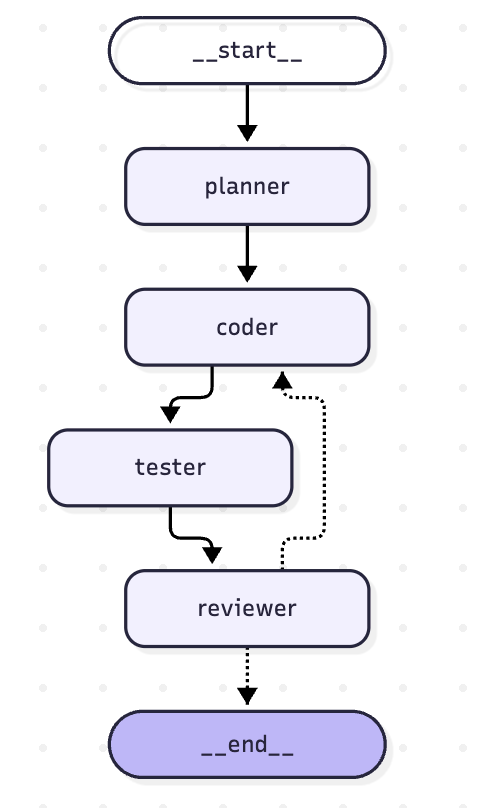
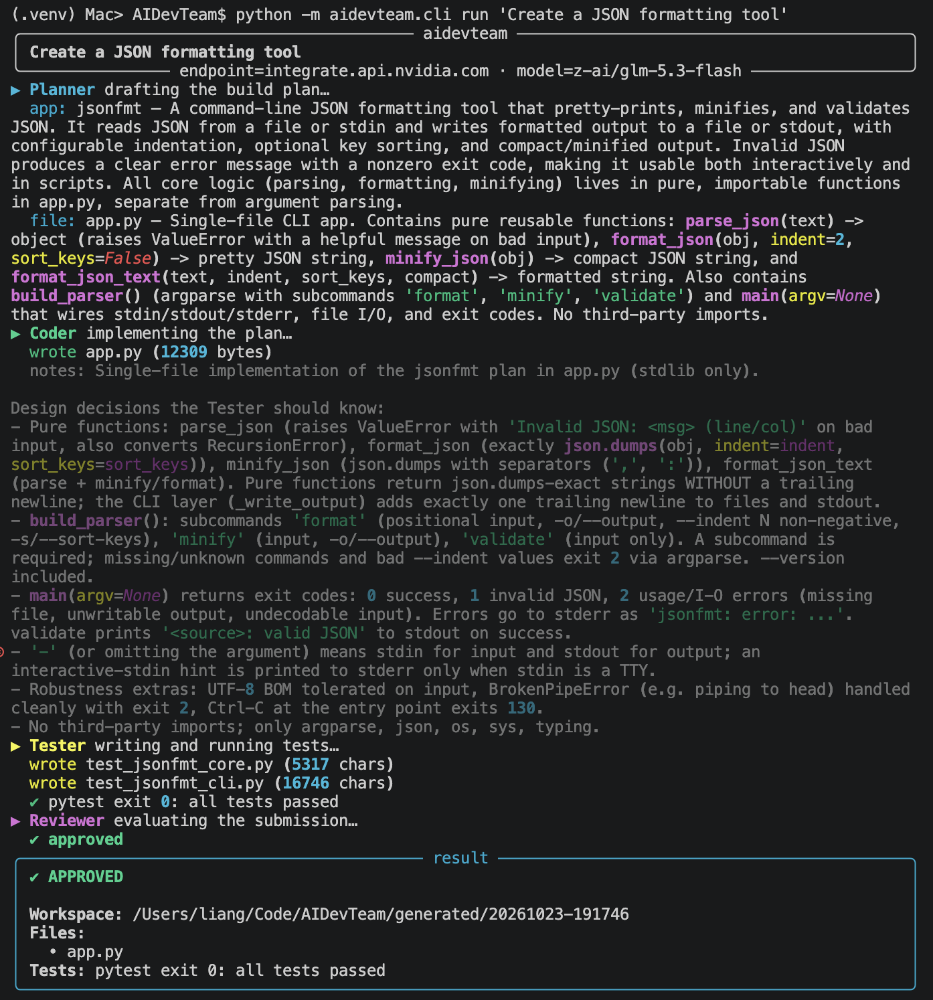
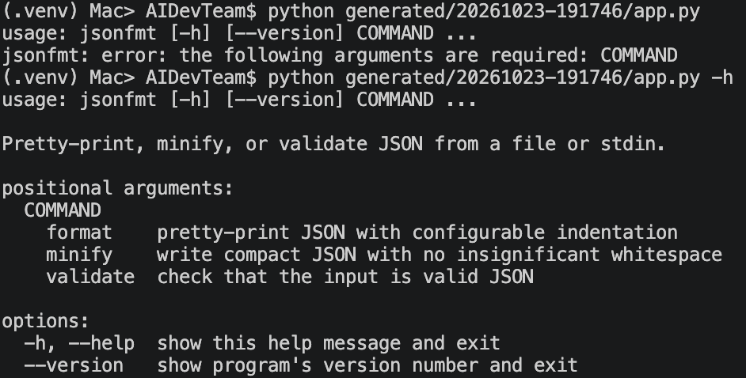
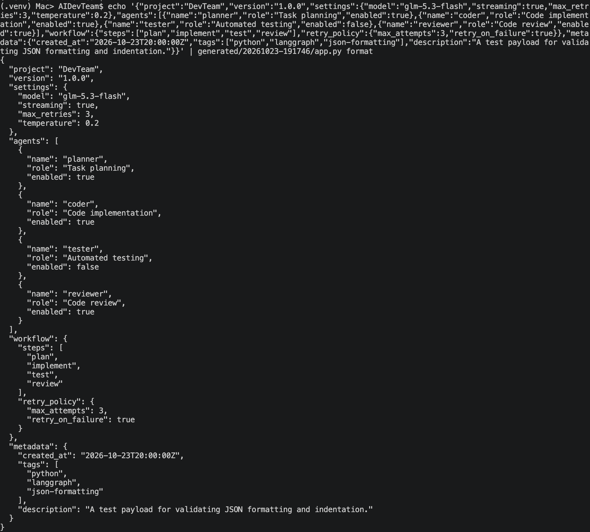

# 从 AI Coding 到 AI 开发团队：第一版 Toy

在上一篇文章中，我介绍了这个项目的初衷：希望通过持续迭代和演化，逐步构建一个真正可用的 AI 开发团队。

但目标再宏大，也得从一个最小的原型开始。

这一篇，我们先做一个 Toy 版本，验证整个思路是否可行。

这里的 Toy，并不是说它毫无实用价值，而是指一个足够简单、能够快速验证核心想法的原型。在这个阶段，我不打算一开始就引入复杂的任务调度、记忆管理和多 Agent 协作机制，而是先跑通最核心的开发闭环。

**先让它跑起来，再考虑如何让它变得更可靠。**

## 一、第一版要做什么？

第一版的目标很明确：

**通过命令行输入开发需求，由 AI 自动完成计划、开发、测试和代码审查，最终生成一个简单的 Python 程序。**

整个流程可以概括为四个步骤：

1. **Plan：** 理解需求，制定开发计划。
2. **Code：** 根据计划编写代码。
3. **Test：** 执行测试，验证代码是否符合预期。
4. **Review：** 检查执行结果，决定任务是否完成，或者反馈问题并进入下一轮修改。

如果测试或审查发现问题，系统就会将反馈交给开发节点，让它尝试修复，然后重新测试和审查。

整体流程如下：



看起来并不复杂，但它包含了我希望这个项目具备的几个基本特征：

- 开发过程不是一次性的代码生成，而是一个完整的工作流。
- 每个环节都有相对明确的职责。
- 开发结果需要经过测试和审查，而不是由模型自行宣布完成。
- 发现问题后，可以根据反馈重新执行开发流程。
- 工作流需要有明确的结束条件，避免无限循环。

第一版只针对简单的 Python 程序，不追求复杂的工程能力。先验证这个闭环能否稳定运行，再考虑如何扩展。

## 二、用 LangGraph 组织 Agent 协作

### 1. 有向图：明确每个 Agent 的执行顺序

第一版采用 LangGraph 来编排整个工作流。

核心代码如下：

```python
# 创建工作流
graph = StateGraph(TeamState)

# 添加四个节点
graph.add_node("planner", plan_node)
graph.add_node("coder", code_node)
graph.add_node("tester", test_node)
graph.add_node("reviewer", review_node)

# 定义节点之间的流转关系
graph.add_edge(START, "planner")
graph.add_edge("planner", "coder")
graph.add_edge("coder", "tester")
graph.add_edge("tester", "reviewer")

# 根据审查结果决定继续开发还是结束
graph.add_conditional_edges(
    "reviewer",
    _route_after_review,
    {
        "coder": "coder",
        END: END,
    },
)
```

这段代码基本上就是整个第一版工作流的骨架。

在 LangGraph 中，可以把工作流理解为一张有向图：节点负责执行具体任务，边负责定义执行路径，状态则负责在节点之间传递信息。

这里需要特别说明一点：

**一个节点不一定对应一个独立的 Agent。**

在当前实现中，我将 Planner、Coder、Tester 和 Reviewer 分别封装为不同的节点，以便清晰地划分职责。但节点本身只是工作流中的执行单元，内部既可以调用 LLM，也可以执行普通 Python 代码，或者组合多种操作。

如果后续发现某个节点的职责过于复杂，可以继续拆分；如果某些步骤根本不需要 LLM，也没有必要为了追求多 Agent 的形式而强行引入模型调用。

### 2. 条件流转：让开发过程形成闭环

与单纯按照顺序执行的流程相比，这里最关键的是 Reviewer 后面的条件边：

```python
graph.add_conditional_edges(
    "reviewer",
    _route_after_review,
    {
        "coder": "coder",
        END: END,
    },
)
```

Reviewer 不只是输出一段审查意见，还会影响整个工作流接下来如何执行。

当审查发现问题时，工作流可以返回 Coder，让它根据反馈继续修改代码；当任务满足结束条件时，则进入 `END`，结束本轮执行。

于是，我们的AI团队就以迭代的流程进行运作：

```text
             ┌─────────────────────┐
             │                     │
             ▼                     │
Plan → Code → Test → Review ───────┘
                           │
                           ▼
                          End
```

其中，Review 到 Code 的回路代表发现问题后重新开发；Review 到 End 则代表任务满足结束条件。

这是我选择显式工作流编排的一个重要原因。

与完全依赖模型自由决定下一步做什么相比，将关键的执行路径和退出条件交给工作流控制，可以让系统更容易理解、调试和约束。

当然，条件边本身并不能保证任务一定成功。它只是提供了控制流程的机制，最终是否应该继续、何时停止，仍然取决于审查逻辑、验证结果和相关约束。

例如，如果每次修改都无法通过测试，系统就需要有最大迭代次数等限制，避免不断重复同样的失败。

第一版先建立基本的回路，后续再逐步完善这些控制机制。

## 三、TeamState：节点之间如何共享信息？

既然工作流由多个节点组成，那么下一个问题就是：这些节点如何共享信息？

在当前实现中，我使用 `TeamState` 作为工作流的状态载体。

```python
class TeamState(TypedDict, total=False):
    """State flowing through the Planner → Coder → Tester → Reviewer graph."""

    task: str
    workspace: str
    plan: Plan
    code: CodeResult
    test_report: TestReport
    review: Review
    feedback: list[str]
    iteration: int
    approved: bool
```

从字段名称就可以大致看出各个环节之间的协作关系：

- `task`：用户输入的原始需求。
- `workspace`：当前任务使用的工作空间。
- `plan`：Planner 生成的开发计划。
- `code`：Coder 的执行结果。
- `test_report`：Tester 生成的测试报告。
- `review`：Reviewer 的审查结果。
- `feedback`：开发过程中积累的问题反馈。
- `iteration`：当前迭代次数。
- `approved`：当前任务是否满足批准条件。

举个例子，Planner 完成任务分析后，将开发计划写入plan字段；Coder 根据计划生成代码；Tester 执行测试后，将测试结果写入test_report字段；最后 Reviewer 综合代码和测试结果，决定是否需要继续修改。

这样，每个节点都不必依赖前一个节点的完整对话历史，而是可以从统一的状态中读取自己需要的信息。

相比单纯把所有上下文不断追加到一段对话中，这种方式更便于明确数据结构、控制信息传递，并在后续扩展时定位问题。

当然，共享状态并不意味着所有信息都应该无差别地放进 State。随着任务变复杂，还需要考虑哪些信息应该长期保留、哪些只在当前步骤使用，以及如何避免状态不断膨胀。

对于第一版来说，先把核心的任务信息和执行结果组织清楚就足够了。

### 关于 State 更新的一点理解

这里有一个值得注意的地方。

在 LangGraph 中，节点通常接收当前状态，并返回本次执行产生的状态更新。例如：

```python
def some_node(state: TeamState) -> dict:
    result = do_something(state)

    return {
        "feedback": result.feedback,
    }
```

这里返回的是本次节点希望更新的字段，而不必须重新构造整个 `TeamState`。

所以对State字段的显式划分，让每个节点的输入、输出和职责更加清晰，也方便后续调试和测试。

## 四、LLM 调用：尽量使用结构化输出

有了工作流和状态，接下来就是让各个节点真正具备执行能力。

目前，核心的 LLM 调用使用 LangChain 提供的 `ChatOpenAI` 接口。

调用方式大致如下：

```python
messages: list = [
    SystemMessage(content=CODER_SYSTEM),
    HumanMessage(
        # 在这里组织当前任务、开发计划和相关上下文
        ...
    ),
]

# 根据指定的 Schema 获取结构化输出
result = llm.with_structured_output(
    schema,
    method="function_calling",
).invoke(messages)
```

这里有两个值得关注的设计点。

### 1. 通过统一接口适配不同模型

目前不少模型服务提供 OpenAI 兼容接口，因此可以通过统一的客户端封装模型调用，而不必针对每个供应商重新编写一套调用逻辑。

这为后续切换模型提供了便利。

不过，接口兼容并不代表能力完全一致。

不同供应商对结构化输出、工具调用、上下文长度等功能的支持可能存在差异。即使调用接口相同，模型的代码生成能力、指令遵循能力和多轮修复能力也可能有明显区别。

因此，统一接口解决的是接入方式的问题，而模型是否适合当前任务，仍然需要通过实际测试来判断。

### 2. 尽可能使用结构化输出

如果让模型直接返回一大段自然语言，后续节点就需要从文本中提取开发计划、测试结论或者审查意见。

这种方式不仅增加了解析成本，也容易因为输出格式变化而引入额外的不确定性。

因此，在适合的节点中，我会使用 `with_structured_output()`，让模型按照预先定义的 Schema 返回结果。

例如：

- Planner 输出结构化的开发步骤。
- Tester 返回包含执行状态和错误信息的测试报告。
- Reviewer 输出审查结论与具体反馈。

这样，节点之间传递的不只是自然语言，而是具有明确字段和类型约束的数据。

需要注意的是，结构化输出主要解决的是输出格式和数据组织问题，并不能保证模型给出的内容一定正确。

一个格式完全正确的开发计划，仍然可能存在逻辑错误；一份结构完整的测试报告，也不意味着程序已经满足需求。

因此，测试、审查和实际执行仍然不可缺少。

## 五、为什么先从免费模型开始？

在模型选择上，目前我先使用 NVIDIA NIM 提供的模型进行测试。

原因很简单：免费的香啊。

开个玩笑。

更重要的是，我想借这个机会了解当前免费模型的实际能力边界。

对于 AI 开发团队来说，模型不仅需要理解需求、编写代码，还需要根据错误信息进行分析，并在多轮迭代中保持相对稳定的执行质量。

模型的一次调用表现不错，并不代表整个流程就一定可靠。一次任务可能涉及多次模型调用，任何一个关键环节出错，都可能影响最终结果。

因此，后续除了记录任务成功率，还可以进一步观察平均迭代次数、测试通过率、模型调用成本，以及失败主要发生在哪个环节。

目前的测试范围还比较有限，暂时不能据此判断免费模型是否足以支撑更复杂的工程任务。

先用真实任务摸清它的能力边界，再决定后续该如何选择和组合模型。


## 六、玩一下这个 Toy

前面介绍了第一版的目标和结构，接下来直接让它执行一个真实任务。

这次，我们不手动编写代码，而是让 AI 开发团队尝试生成一个 JSON 格式化工具。

### 1. 提出开发需求

在命令行中输入需求：

```bash
AIDevTeam$ python -m aidevteam.cli run 'Create a JSON formatting tool'
```



系统会按照预先定义的工作流执行任务：先制定开发计划，再生成代码、运行测试，最后由 Reviewer 检查结果，并根据执行情况决定是否需要继续修改。

这里值得关注的是，我们只提供了一句自然语言需求，后续的计划、开发和测试都交给工作流处理。

这正是第一版希望验证的核心能力。

### 2. 运行生成的程序

生成的代码在 ./generated/ 目录中。接下来，试着运行它生成的代码。



从实际运行结果来看，生成的工具已经具备了比较完整的基本功能。

当然，代码成功生成只是第一步。对于 AI 开发工作流来说，更重要的是生成的程序能否真正执行，以及执行结果是否符合预期。

### 3. 测试 JSON 格式化功能

继续传入一个 JSON 字符串，验证工具能否正常处理输入并输出格式化后的结果。



测试成功。

至此，我们完成了一次从需求输入、代码生成，到测试和实际运行的完整流程。

### 4. 第一阶段达成

这次实验远不足以证明系统能够稳定完成任意软件开发任务，但验证了一个重要方向：

**我们可以将 AI 的代码生成能力组织进一个具有明确执行步骤、测试环节和结束条件的工作流中，并让它实际产出可运行的程序。**

我们会继续这个知行实践，看看这个 Toy 最终能演化成什么模样

## 附记
第一版的完整代码在： [AIDevTeam v1](https://github.com/bubuguo/AIDevTeam/tree/v1)

最后，留一个问题：
**当前这个 AI 开发团队的实现中，最大的安全问题是什么？**
